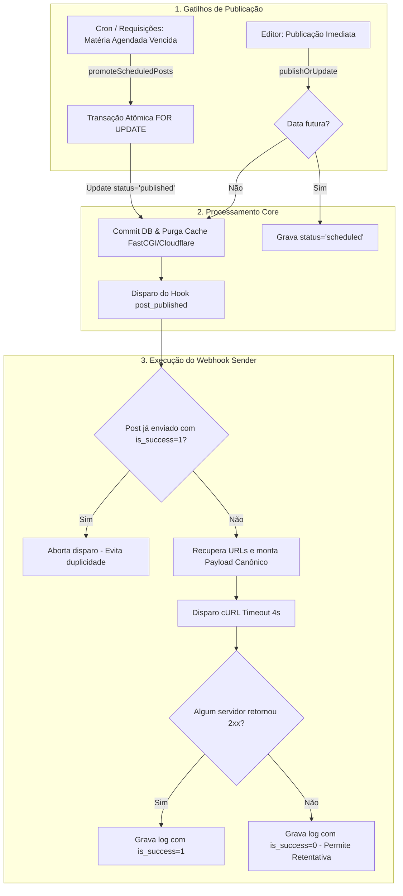

# Documentação Técnica: Plugin Webhook Sender (LightPress)

---

## 1. Visão Geral

O **Webhook Sender** (`webhook-sender`) é o primeiro plugin oficial desenvolvido para o ecossistema **LightPress / SpeedPress**.

Seu objetivo é enviar automaticamente notificações via HTTP POST para um ou múltiplos servidores externos (como canais do Discord, Slack, instâncias do n8n, Zapier ou webhooks de microserviços proprietários) sempre que uma nova matéria for publicada ou atingir seu horário programado de agendamento.

---

## 2. Origem e Evolução: Portabilidade do WordPress

O plugin foi concebido a partir da migração e aprimoramento do plugin legado do WordPress (`c:\Web\suainternet\plugins\discord-auto-sender\discord-auto-sender.php`).

### Comparativo: WordPress vs. LightPress

| Aspecto | No WordPress Tradicional | No LightPress (Zero Bloatware) |
| :--- | :--- | :--- |
| **Linguagem & Tipagem** | PHP legado, funções globais, sem tipagem estrita | **PHP 8.4 puro**, `declare(strict_types=1);`, tipagem forte |
| **Persistência de Estado** | Tabela EAV fragmentada (`wp_postmeta`) com chaves `_das_discord_pending` e `_das_discord_sent` | **Tabela relacional dedicada e indexada** (`plugin_webhook_sender_logs`) com chave estrangeira e `ON DELETE CASCADE` |
| **Escopo de Servidores** | Exclusivo para canais do Discord | **Universal (Discord, Slack, n8n, Zapier e endpoints HTTP REST)** com suporte a múltiplos destinos separados por vírgula |
| **Momento do Disparo** | Durante hooks de save, sujeito a travar a transação e o salvamento na interface | **Estritamente pós-commit e pós-purga de cache**, em requisição cURL não-bloqueante (timeout 4s) |
| **Matérias Agendadas** | Dependia do `wp-cron` aleatório disparado por visitantes | **Auto-promoção atômica transacional** (`FOR UPDATE`) executada via cron dedicado de 1 minuto ou acessos ao portal |
| **Falhas de Entrega** | Gravava como enviado mesmo em caso de erro HTTP | **Controle inteligente de sucesso (`is_success`)**: falhas HTTP não bloqueiam retentativas futuras |
| **Assets Públicos** | Carregava estilos e scripts dentro da pasta de plugins via PHP | **Entrega estática de alta performance no Nginx** a partir de `/public/assets/plugins/` |

---

## 3. Arquitetura e Ciclo de Vida do Plugin

### 3.1. Estrutura de Arquivos

```text
lightpress/
├── plugins/
│   └── webhook-sender/
│       ├── plugin.json                # Manifesto declarativo de metadados
│       ├── webhook-sender.php         # Entrypoint principal, serviço e escuta de hooks
│       └── settings.php               # Painel de configurações, teste de ping e histórico
```

### 3.2. Manifesto Declarativo (`plugin.json`)

O arquivo `plugin.json` permite que o `PluginManager` do LightPress liste, inspecione e disponibilize o plugin no painel administrativo sem necessidade de executar qualquer linha de código PHP antes da ativação.

```json
{
  "id": "webhook-sender",
  "name": "Webhook Sender",
  "version": "1.0.1",
  "description": "Envia automaticamente notificações para servidores e canais via Webhook ao publicar matérias.",
  "author": "Carlos Eduardo de Araújo / LightPress",
  "author_url": "https://lightpress.org",
  "min_lp_version": "1.0.0",
  "admin_settings": true,
  "admin_title": "Webhook Sender",
  "requires_db": true
}
```

### 3.3. Modelo de Dados Relacional (`plugin_webhook_sender_logs`)

Respeitando as diretrizes fundamentais do `README.md` (eliminação total do modelo EAV `postmeta`), o plugin cria e mantém uma tabela relacional própria:

```sql
CREATE TABLE IF NOT EXISTS plugin_webhook_sender_logs (
    post_id INT UNSIGNED PRIMARY KEY,
    sent_at DATETIME NOT NULL DEFAULT CURRENT_TIMESTAMP,
    servers_count INT UNSIGNED NOT NULL DEFAULT 1,
    is_success TINYINT(1) NOT NULL DEFAULT 0,
    last_response_codes TEXT NULL,
    CONSTRAINT fk_pws_post FOREIGN KEY (post_id) REFERENCES posts (id) ON DELETE CASCADE
) ENGINE=InnoDB DEFAULT CHARSET=utf8mb4 COLLATE=utf8mb4_unicode_ci;
```

* `post_id`: Chave primária indexada com exclusão em cascata (se a matéria for deletada do portal, seus logs de webhook são removidos automaticamente pelo banco).
* `sent_at`: Data e hora em UTC do último disparo.
* `servers_count`: Quantidade de servidores notificados.
* `is_success`: Flag booleana (`1` para entrega bem-sucedida, `0` para falha).
* `last_response_codes`: Registro em JSON com a URL de cada destino e o código de resposta HTTP retornado (ex: `{"https://discord...": 204}`).

---

## 4. Fluxos Operacionais e Funcionalidades



### 4.1. Publicação Imediata vs. Matérias Agendadas

1. **Publicação Imediata (`PostService::publishOrUpdate()`):**
   - Ao clicar em *Publicar Agora*, a matéria recebe `status = 'published'`.
   - Após a confirmação da transação no banco e a purga de cache no Nginx e Cloudflare, o hook `Hook::doAction('post_published', $postId, $data, $current, $isFirstPublish)` é disparado.

2. **Matérias Agendadas para o Futuro:**
   - Ao agendar com data futura, a matéria é salva com `status = 'scheduled'`. O webhook **não é enviado prematuramente**, evitando divulgar links que ainda resultariam em erro 404 para os leitores.
   - **Auto-Promoção Atômica (`PostService::promoteScheduledPosts()`):**
     - Executada a cada 1 minuto pelo cron do servidor (`bin/retry-cache-purge.php` ou `bin/cleanup.php`) e também na abertura de páginas públicas/administrativas.
     - Executa um `SELECT ... FOR UPDATE` com `UPDATE posts SET status = 'published'` dentro de uma transação isolada, garantindo proteção contra condições de corrida entre requisições simultâneas.
     - Carrega os dados editoriais completos (`title`, `summary`, `tags`, `featured_image`, `content_html`, `published_at`) e dispara o hook `post_published`, notificando os webhooks no momento exato em que a matéria entra no ar.

### 4.2. Suporte a Múltiplos Servidores

O campo de configuração aceita múltiplas URLs separadas por vírgula (`,`) ou por quebra de linha. O serviço `WebhookSenderService::parseUrls()` higieniza as entradas, remove espaços, descarta protocolos inválidos e aceita apenas URLs `http://` e `https://` válidas.

### 4.3. Resolução Canônica em Ambiente CLI / Cron

Em execuções de terminal ou agendador de tarefas (onde a variável de servidor `$_SERVER['HTTP_HOST']` não existe), o método `buildPayload()` consome prioritariamente a diretiva `'canonical_origin'` (`https://www.speedracing.com.br`) do arquivo de configuração (`config.local.php` / `config.php`). Isso garante que os links e imagens das notícias gerados no webhook sejam sempre absolutos e válidos.

### 4.4. Resiliência e Tratamento de Falhas de Entrega

- O envio para os servidores roda com timeout estrito de conexão (3s) e de resposta (4s).
- Se todos os servidores retornarem erro HTTP (ex: `404`, `500` ou timeout `0`), o log é registrado com `is_success = 0`.
- Como a verificação de duplicidade consulta `WHERE post_id = ? AND is_success = 1`, matérias que falharam na entrega **não ficam bloqueadas para sempre**:
  - Uma edição subsequente da matéria tentará enviar novamente.
  - O painel administrativo disponibiliza um botão **Reenviar 🔄** com 1 clique para qualquer matéria registrada na tabela de logs.

---

## 5. Interface Administrativa (`/admin/plugin-settings.php?plugin=webhook-sender`)

A interface administrativa do plugin oferece:
1. **Menu Superior Integrado:** Acesso direto através do dropdown **Plugins ▾ > Webhook Sender**.
2. **Área de Texto com Validação:** Cadastro livre de múltiplos servidores de webhook.
3. **Botão de Teste Interativo (🧪 Testar Envio de Webhook):** Dispara uma mensagem de teste para todos os servidores informados, exibindo na hora o status HTTP individual de cada um (ex: `HTTP 204 (Sucesso)`).
4. **Histórico Relacional em Tempo Real:** Tabela com as últimas 15 notificações, data de envio, quantidade de servidores atingidos, status (`Entregue ✓` ou `Falha ✕`), códigos brutos retornados e botão de **Reenviar 🔄**.

---

## 6. Verificação e Testes Automatizados

O sistema conta com testes automatizados integrados:
* `bin/test-plugins.php`: Valida registro de hooks com prioridade, manifesto, parsing de múltiplos servidores e geração de URLs em CLI/Cron.
* `bin/test.php`: Suíte central do LightPress que integra a verificação de sanidade do sistema de plugins.
